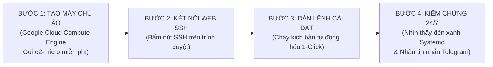

# 📘 CẨM NANG HƯỚNG DẪN TRIỂN KHAI AI AGENT LÊN GOOGLE CLOUD VPS CHẠY 24/7

> **Dành cho học viên nhân sự & phân tích dữ liệu:** Hướng dẫn từng bước trực quan, không cần kiến thức chuyên sâu về quản trị mạng, hoàn toàn thao tác trên trình duyệt web với chi phí 0 đồng.

---

## 🧭 BẢN ĐỒ LỘ TRÌNH 4 BƯỚC ĐƠN GIẢN



---

## 🛠️ BƯỚC 1: KHỞI TẠO MÁY CHỦ ẢO GOOGLE CLOUD (COMPUTE ENGINE)

1. Truy cập [Google Cloud Console](https://console.cloud.google.com/).
2. Trên thanh tìm kiếm, gõ **VM instances** (hoặc chọn menu bên trái: *Compute Engine* $\rightarrow$ *VM instances*).
3. Nhấp vào nút **Create Instance** (Tạo phiên bản máy ảo) và cấu hình đúng 4 thông số sau để được miễn phí:
   * **Name (Tên máy chủ):** `hr-ai-agent-vps`
   * **Region (Khu vực):** Chọn `us-central1 (Iowa)` hoặc `us-west1 (Oregon)` (đây là các khu vực nằm trong định mức miễn phí trọn đời của Google).
   * **Machine configuration (Cấu hình máy):** Chọn dòng **E2**, loại máy **e2-micro** (2 vCPU, 1 GB RAM).
   * **Boot disk (Ổ đĩa khởi động):** Nhấn *Change* $\rightarrow$ Chọn hệ điều hành **Ubuntu**, phiên bản **Ubuntu 22.04 LTS**, dung lượng ổ đĩa **10 GB** (Standard persistent disk).
   * **Firewall (Tường lửa):** Tích chọn cả hai ô *Allow HTTP traffic* và *Allow HTTPS traffic*.
4. Nhấn **Create** ở cuối trang và đợi khoảng 45 giây cho máy chủ khởi động (xuất hiện dấu tích xanh lá cây bên cạnh tên máy chủ).

---

## 💻 BƯỚC 2: KẾT NỐI VÀO MÁY CHỦ BẰNG WEB SSH TRÊN TRÌNH DUYỆT

* Tại cột **Connect** trên danh sách máy chủ, nhấp chuột trái vào chữ **SSH**.
* Một cửa sổ trình duyệt màu đen xuất hiện. Google Cloud sẽ tự động kết nối bảo mật đến máy chủ của bạn mà không cần cài đặt bất kỳ phần mềm nào vào máy tính cá nhân.

---

## 📥 BƯỚC 3: ĐƯA MÃ NGUỒN VÀ THIẾT LẬP DỊCH VỤ TỰ ĐỘNG

Trong màn hình SSH màu đen, bạn lần lượt sao chép và dán 3 khối lệnh sau:

### Lệnh 3.1: Cập nhật hệ điều hành và cài đặt môi trường nền
```bash
sudo apt update && sudo apt install -y python3-pip python3-venv git
```

### Lệnh 3.2: Tải mã nguồn bài học về máy chủ
```bash
# Tạo thư mục chứa các tác nhân thông minh
mkdir -p ~/ai-agents && cd ~/ai-agents

# Tải bộ mã nguồn Agent Tuyển Dụng & Keep-Alive về máy
# (Bạn có thể tải trực tiếp thư mục Agent_Kit từ Google Drive hoặc kho GitHub lớp học)
```

### Lệnh 3.3: Cấu hình khóa bí mật vào file `.env` và xác thực Google Service Account
Di chuyển vào thư mục của tác nhân tuyển dụng:
```bash
cd ~/ai-agents/agent_1_cv_extract
cp .env.example .env
nano .env
```
*Dùng các phím mũi tên di chuyển đến dòng `GEMINI_API_KEY`, dán khóa API của bạn vào. Cập nhật `GOOGLE_SHEET_ID` và thông tin Telegram. Nhấn `Ctrl + O` rồi nhấn `Enter` để lưu, sau đó nhấn `Ctrl + X` để thoát ra.*

### Lệnh 3.4: Đặt tệp xác thực Google Service Account (credentials.json)
1. Tải tệp JSON của tài khoản dịch vụ từ Google Cloud Console về máy tính.
2. Mở bảng tính Google Sheets và thư mục Google Drive, bấm nút **Chia sẻ** và thêm địa chỉ thư điện tử `client_email` của tài khoản dịch vụ vào với quyền **Chỉnh sửa (Editor)**.
3. Đổi tên tệp thành `credentials.json` và tải lên thư mục `~/ai-agents/agent_1_cv_extract/` (Bạn có thể tham khảo cấu trúc mẫu tại `credentials.json.example`).


---

## 🚀 BƯỚC 4: KÍCH HOẠT DỊCH VỤ CHẠY 24/7 VỚI SYSTEMD

Phân quyền và chạy kịch bản tự động:
```bash
chmod +x service_setup.sh
./service_setup.sh
```

### Cách kiểm tra kết quả ngay lập tức:
* **Kiểm tra trạng thái máy chủ:**
  ```bash
  sudo systemctl status ai-agent-cv-extract
  ```
  *Nếu nhìn thấy dòng chữ màu xanh lá cây `Active: active (running)` nghĩa là tác nhân đã chính thức đi vào hoạt động 24/7.*

* **Xem dòng suy luận của AI theo thời gian thực:**
  ```bash
  sudo journalctl -u ai-agent-cv-extract -f
  ```

---

## 🎯 BƯỚC 5: KIỂM CHỨNG KẾT QUẢ THỰC TẾ

1. Thả một tập tin hồ sơ ứng viên vào thư mục `sample_cvs` hoặc thư mục quét.
2. Kiểm tra điện thoại: Ứng dụng Telegram sẽ rung chuông báo tin nhắn chi tiết kèm họ tên, điểm số và nhận xét năng lực của ứng viên.
3. Mở Google Sheets: Dòng thông tin ứng viên đã được điền đầy đủ và ngay ngắn, số điện thoại được bảo toàn số 0 ở đầu.
4. Tắt máy tính cá nhân của bạn: AI Agent trên Google Cloud VPS vẫn tiếp tục miệt mài làm việc 24/7!
